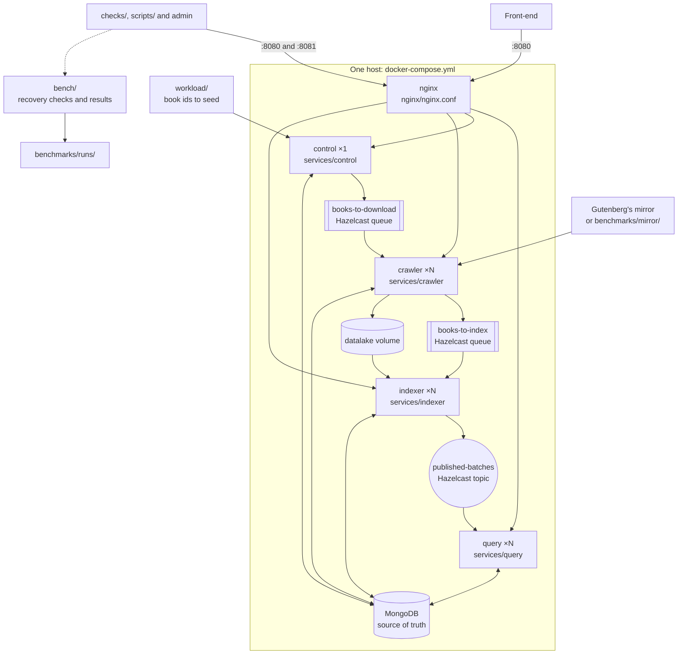

# Query Tarantino · Stage 2

[](https://github.com/Query-Tarantino/stage_2/actions/workflows/ci.yml?query=branch%3Adev)
[](https://github.com/Query-Tarantino/stage_2/actions/workflows/codeql.yml?query=branch%3Adev)

Search engine over [Project Gutenberg](https://www.gutenberg.org/) books in Java 25, with Javalin and Jackson.
`crawler` downloads books, `indexer` indexes them in batches, `query` searches them with TF-IDF and `control`
seeds and reconciles. The services keep the texts in a datalake and the source of truth in MongoDB, coordinate
through Hazelcast by default or in one of three other modes, and everything runs on one machine with Docker Compose.

## Documentation

| Guide | What it covers |
| --- | --- |
| [docs/running.md](docs/running.md) | Starting the stack, every endpoint to try, ports, variables, replicas and JVM, a service outside Compose, and the five coordination modes |
| [checks/README.md](checks/README.md) | The functional API checks and the OpenAPI validation, in every mode |
| [scripts/bench/README.md](scripts/bench/README.md) | The benchmark corpus, each experiment with its official run, JMH, summarising a run again, and the campaign |
| [scripts/recovery/README.md](scripts/recovery/README.md) | One script per row of the failure matrix, and comparing the runs of a row |
| [benchmarks/README.md](benchmarks/README.md) | What the runs show: the figures, the hypotheses and the bottlenecks |
| [SPEC.md](SPEC.md) | Every contract: collections, messages, states, conditional writes, the HTTP API, the search algorithm, the failure matrix and the benchmark runs |
| [api/openapi.yaml](api/openapi.yaml) | The HTTP API in OpenAPI 3.1, derived from `SPEC.md` §6 |
| [report/QueryTarantino_Stage2_Report.pdf](report/QueryTarantino_Stage2_Report.pdf) | The Stage 2 report; its single-file LaTeX source, [QueryTarantino_Stage2_Report.tex](report/QueryTarantino_Stage2_Report.tex), builds from `report/` with `tectonic -X compile QueryTarantino_Stage2_Report.tex` |

## Structure

The folders of this repository at run time, in the default mode `hazelcast`: `control` seeds the book ids of
`workload/`, `crawler` downloads them into the datalake, `indexer` publishes them in batches and `query` searches them
behind nginx. The four services share `common/` and one image built from the `Dockerfile`, and MongoDB is the source of
truth. `SPEC.md` §2.1 has the full diagram, with every message, port and thread, and §11 what the other modes change.



## Status

The system runs end to end in its five coordination modes: `control` seeds the candidates and reconciles, `crawler`
downloads them, `indexer` publishes them in batches and `query` answers the search API behind nginx, and the functional
checks pass in every mode. The official campaign of `scripts/bench/all.sh`, `20261105-215348-campaign-c1376c7`, ran
every experiment and the recovery matrix in every mode on the official machine, and every row of the matrix recovers
with the same answers in every mode where it applies. Its runs are in `benchmarks/runs/` with the two November runs
it reuses because their code did not change, and [benchmarks/README.md](benchmarks/README.md) reads them (`SPEC.md` §9).

## Requirements

- Java 25 and Maven 3.9+
- Docker with Compose, for MongoDB and Hazelcast and for the Testcontainers tests
- Bash 4 or later for the scripts in `scripts/`; macOS ships 3.2, so install a newer one first with `brew install bash`

On macOS with [Colima](https://github.com/abiosoft/colima) instead of Docker Desktop, export first:

```bash
export DOCKER_HOST="unix://$HOME/.colima/default/docker.sock"
export TESTCONTAINERS_DOCKER_SOCKET_OVERRIDE=/var/run/docker.sock
```

## Build and test

```bash
mvn clean verify                              # every module, with the MongoDB tests on Testcontainers
mvn -pl services/indexer -am verify           # one module with what it needs
```

Without Docker, the Testcontainers tests are skipped, not failed. `mvn verify` also runs the cases of
`workload/conformance/` that still apply (`SPEC.md` §10), and JaCoCo writes the line and branch coverage of each
module to `target/site/jacoco/index.html`.

GitHub Actions runs on every push `mvn clean verify`, failing if the MongoDB tests were skipped; the functional checks
against the stack with the 20 sample books, in mode `hazelcast` with one `query` replica and then with three behind
nginx, and once in each other coordination mode; and the workflow and shell linters. CodeQL scans every pull request
to `dev` and `main`. Every row of the failure matrix runs with 1, 2 and 3 replicas on the benchmark corpus, as the
official runs do, on every pull request to `main`, and to `dev` when it changes `scripts/recovery/`; those runs are
test runs (`SPEC.md` §9), kept as workflow artifacts and never committed. The workflows are in `.github/workflows/`.

## Running

```bash
mvn -DskipTests package
docker compose -f docker-compose.yml -f docker-compose.mirror.yml up -d --build   # books from benchmarks/mirror
curl 'http://localhost:8080/search?q=pride%20prejudice'
docker compose down -v                                                             # stop and delete the data
```

[docs/running.md](docs/running.md) has every endpoint, setting and coordination mode.

## Repository

```text
report/
  QueryTarantino_Stage2_Report.pdf  the Stage 2 report
  QueryTarantino_Stage2_Report.tex  its LaTeX source, with the rows it takes from the runs
common/                 shared contracts: names, records, JSON, configuration, tokenizer, Mongo, Hazelcast, HTTP
services/
  crawler/              Ingestion
  indexer/              Indexing
  query/                Search
  control/              seeding and reconciliation
bench/                  load generator, recovery checks and benchmark metrics
checks/                 functional API checks (F4) and OpenAPI validation
api/openapi.yaml        HTTP API
nginx/nginx.conf        entry ports 8080 and 8081, and 8082 for the internal routes of mode orchestrator
docker-compose.yml      the stack; docker-compose.mirror.yml adds the local mirror
docker-compose.*.yml    one override per coordination mode other than hazelcast
activemq/activemq.xml   the ActiveMQ broker configuration, with its statistics plugin
Dockerfile              the image of the four services
scripts/
  fill_cache.sh         benchmark corpus
  bench/                one script per experiment, the shared trials.sh and modes.sh, and all.sh for the campaign
  recovery/             one script per row of the failure matrix, and lib.sh
benchmarks/
  README.md             what the runs show
  runs/<run_id>/        every benchmark and recovery run, versioned
docs/running.md         running and configuration
.github/                CI, CodeQL and the recovery workflow
workload/
  book_ids.txt          corpus candidates, in order
  sample_ids.txt        20 books of the corpus, seeded by default
  queries.txt           search benchmark queries
  stopwords.txt         stopwords removed by the tokenizer
  conformance/          inherited rule cases, in JSON
```

The services follow the Stage 1 hexagonal layout, `model`, `ports`, `adapters` and `commands`, wired by each
`Main` and its factory (`SPEC.md` §3). `SPEC.md` §2.3 has the full layout and the owner of each path.
Benchmark and recovery runs go in `benchmarks/runs/<run_id>/`, which is versioned; `benchmarks/cache/`,
`benchmarks/mirror/` and `datalake/` are not.
