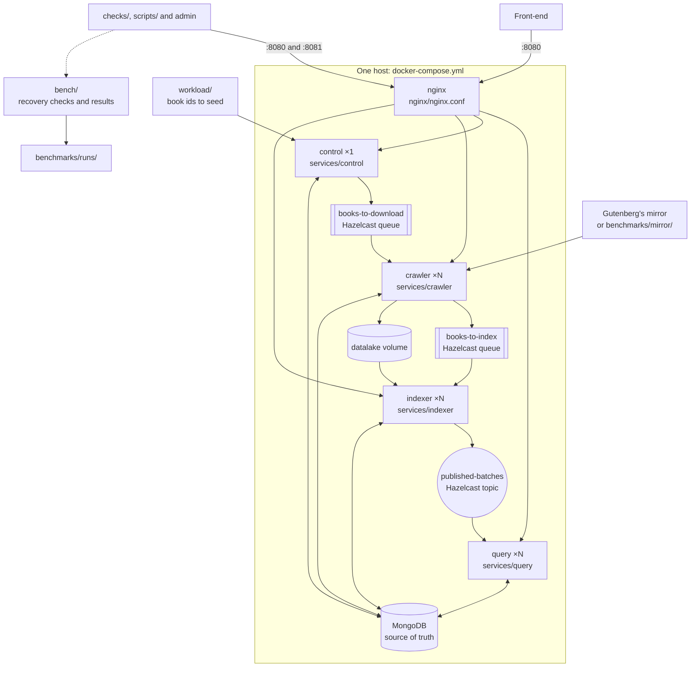

# Query Tarantino · Stage 2

[](https://github.com/Query-Tarantino/stage_2/actions/workflows/ci.yml?query=branch%3Adev)
[](https://github.com/Query-Tarantino/stage_2/actions/workflows/codeql.yml?query=branch%3Adev)

Search engine over [Project Gutenberg](https://www.gutenberg.org/) books in Java 25, with Javalin and Jackson.
`crawler` downloads books, `indexer` indexes them in batches, `query` searches them with TF-IDF and `control`
seeds and reconciles. The services keep the texts in a datalake and the source of truth in MongoDB, coordinate
through Hazelcast by default or in one of three other modes, and everything runs on one machine with Docker Compose.

- [report/QueryTarantino_Stage2_Report.pdf](report/QueryTarantino_Stage2_Report.pdf) is the Stage 2 report. Its LaTeX
  source, [report/QueryTarantino_Stage2_Report.tex](report/QueryTarantino_Stage2_Report.tex), is one file that also holds
  the rows it takes from the runs, and `tectonic -X compile QueryTarantino_Stage2_Report.tex` builds it from `report/`.
- [SPEC.md](SPEC.md) holds every contract: collections, messages, states, conditional writes, the HTTP API,
  the search algorithm, the failure matrix and the benchmark runs.
- [api/openapi.yaml](api/openapi.yaml) is the HTTP API in OpenAPI 3.1, derived from `SPEC.md` §6.

## Structure

The folders of this repository at run time, in the default mode `hazelcast`: `control` seeds the book ids of
`workload/`, `crawler` downloads them into the datalake, `indexer` publishes them in batches and `query` searches them
behind nginx. The four services share `common/` and one image built from the `Dockerfile`, and MongoDB is the source of
truth. `SPEC.md` §2.1 has the full diagram, with every message, port and thread, and §11 what the other modes change.



## Status

The system runs end to end in its five coordination modes: `control` seeds the candidates and reconciles, `crawler`
downloads them, `indexer` publishes them in batches and `query` answers the search API behind nginx, and the functional
checks pass in every mode. The official campaign of `scripts/bench/all.sh`, `20261105-215348-campaign-c1376c7`, ran
every experiment and the recovery matrix in every mode on the official machine, and every row of the matrix recovers
with the same answers in every mode where it applies. Its runs are in `benchmarks/runs/` with the two November runs
it reuses because their code did not change, and [benchmarks/README.md](benchmarks/README.md) reads them (`SPEC.md` §9).

## Requirements

- Java 25 and Maven 3.9+
- Docker with Compose, for MongoDB and Hazelcast and for the Testcontainers tests
- Bash 4 or later for the scripts in `scripts/`; macOS ships 3.2, so install a newer one first with `brew install bash`

On macOS with [Colima](https://github.com/abiosoft/colima) instead of Docker Desktop, export first:

```bash
export DOCKER_HOST="unix://$HOME/.colima/default/docker.sock"
export TESTCONTAINERS_DOCKER_SOCKET_OVERRIDE=/var/run/docker.sock
```

## Build and test

```bash
mvn clean verify                              # every module, with the MongoDB tests on Testcontainers
mvn -pl services/indexer -am verify           # one module with what it needs
```

Without Docker, the Testcontainers tests are skipped, not failed. `mvn verify` also runs the cases of
`workload/conformance/` that still apply (`SPEC.md` §10), and JaCoCo writes the line and branch coverage of each
module to `target/site/jacoco/index.html`.

GitHub Actions runs on every push `mvn clean verify`, failing if the MongoDB tests were skipped; the functional checks
against the stack with the 20 sample books, in mode `hazelcast` with one `query` replica and then with three behind
nginx, and once in each other coordination mode; and the workflow and shell linters. CodeQL scans every pull request
to `dev` and `main`. Every row of the failure matrix runs with 1, 2 and 3 replicas on the benchmark corpus, as the
official runs do, on every pull request to `main`, and to `dev` when it changes `scripts/recovery/`; those runs are
test runs (`SPEC.md` §9), kept as workflow artifacts and never committed. The workflows are in `.github/workflows/`.

## Running

```bash
mvn -DskipTests package
docker compose -f docker-compose.yml -f docker-compose.mirror.yml up -d --build   # books from benchmarks/mirror
curl 'http://localhost:8080/search?q=pride%20prejudice'
curl 'http://localhost:8080/books/1342'
curl 'http://localhost:8080/search/filters'
curl http://localhost:8081/index/status                                           # generation, books indexed and rebuild in progress
curl http://localhost:8081/index/status/1342                                      # state of one book
curl -X POST http://localhost:8081/index/rebuild                                  # reindex every book into the next generation
docker compose down -v                                                             # stop and delete the data
```

Without `docker-compose.mirror.yml`, `crawler` downloads over HTTP from Gutenberg's official mirror. `control` seeds
`workload/sample_ids.txt`, and a book shows up in `/search` once its batch is published: at most
`TARANTINO_BATCH_TIMEOUT_SECONDS` (30 s) after the first download of the batch.

| Setting | How |
| --- | --- |
| Entry ports | Only nginx publishes ports: 8080 sends `/search`, `/search/filters` and `/books/` to `query`, and 8081 sends `/ingest/`, `/index/` and `/control/` to their service; any other path gives `404`. 8081 has no authentication, so it only listens on `127.0.0.1` |
| Service ports | `TARANTINO_PORT`: 7001 `crawler`, 7002 `indexer`, 7003 `query` and 7004 `control`, inside the Compose network, each with its `/health`: `docker compose exec query curl -s localhost:7003/health` |
| Addresses | `TARANTINO_MONGO_URI` and `TARANTINO_HAZELCAST`, which `docker-compose.yml` points to `mongo` and `hazelcast` |
| Data paths | `TARANTINO_DATALAKE` (the `datalake` volume at `/data/datalake`), `TARANTINO_WORKLOAD` (`./workload` at `/app/workload`) and `TARANTINO_MIRROR` (`benchmarks/mirror` at `/data/mirror` with `docker-compose.mirror.yml`) |
| Replicas | `docker compose up -d --scale crawler=3 --scale indexer=3 --scale query=2`; `control` always has one. Downloads at once: `crawler` replicas × `TARANTINO_PARALLEL_DOWNLOADS` (8) |
| HTTP threads | `TARANTINO_HTTP_THREADS`; without it, Javalin's own pool, from 8 to 250 threads |
| Timing | The `TARANTINO_*_SECONDS` variables of `SPEC.md` §4.7, read from the shell by `docker-compose.yml` and the same for every service |
| JVM | `JAVA_TOOL_OPTIONS`, by default `-Xmx512m -XX:+ExitOnOutOfMemoryError` in every service: a JVM that runs out of memory exits instead of losing one thread |
| Download retries | `TARANTINO_MAX_ATTEMPTS` (3): `NETWORK_ERROR` and `STORAGE_ERROR` send the book back to `books-to-download` until then; `NOT_FOUND` and `MISSING_MARKERS` leave it `FAILED` |
| CORS | `TARANTINO_CORS_ORIGIN`, `*` by default, the origin `query` allows |
| Crash points | `CRAWLER_CRASH_AT` and `INDEXER_CRASH_AT` set `TARANTINO_CRASH_AT` of that service only, for the recovery tests (`SPEC.md` §8): `CRAWLER_CRASH_AT=after-claim docker compose up -d --scale crawler=1 crawler` |
| Tools | `docker compose run --rm bench <command>` runs `bench/target/bench-1.0-SNAPSHOT.jar`; it is under the `tools` profile, so `up` never starts it |

Colima's default VM has 2 GiB, which fits one replica of each service; give it more before scaling, for example
`colima start --memory 6`.

Each service is a standalone Maven module that builds an executable jar, `services/<service>/target/<service>-1.0-SNAPSHOT.jar`,
so one can also run on its own outside Compose. Its defaults point to MongoDB and Hazelcast on `localhost`, which
Compose does not publish, so start them first:

```bash
docker run -d --name mongo -p 27017:27017 mongo:7.0
docker run -d --name hazelcast -p 5701:5701 -e HZ_CLUSTERNAME=tarantino hazelcast/hazelcast:5.7.0
TARANTINO_MIRROR=benchmarks/mirror java -jar services/crawler/target/crawler-1.0-SNAPSHOT.jar   # port 7001
docker rm -f mongo hazelcast                                                                    # afterwards
```

Run that way, a service writes its datalake to `datalake/` in the current folder, which git ignores.

### Functional checks and benchmarks

Run the functional API checks (F4) against the running stack and validate every response against `api/openapi.yaml`:

```bash
java -jar checks/target/checks-1.0-SNAPSHOT.jar
```

In another coordination mode, give the checks the mode's Compose files, which they use to reach the service ports from
inside the containers, and the mode itself; in mode `orchestrator` they also check the internal routes of `SPEC.md`
§11.4 from inside the `control` container:

```bash
COMPOSE_FILE=docker-compose.yml:docker-compose.mirror.yml:docker-compose.orchestrator.yml TARANTINO_COORDINATION=orchestrator \
  java -jar checks/target/checks-1.0-SNAPSHOT.jar
```

Regenerate `checks/expected.json` when the corpus or schema changes:

```bash
java -jar checks/target/checks-1.0-SNAPSHOT.jar --generate-expected
```

Each experiment of `SPEC.md` §9 is one script, run from a clean commit with `mvn -DskipTests package` done; each
writes its own `benchmarks/runs/<run_id>/`:

| Experiment | Command | Official run |
| --- | --- | --- |
| Ingestion throughput by crawler replicas and workers | `./scripts/bench/ingest-throughput.sh` | `20261105-215351-ingest-throughput-c1376c7` |
| Indexing throughput by batch size and indexer replicas, rebuilding the index once per trial | `./scripts/bench/index-throughput.sh` | `20261105-220915-index-throughput-c1376c7`, with the indexer's JMH of `20261103-204454-index-throughput-6925d4e` |
| Search latency by clients, HTTP threads and `query` replicas | `./scripts/bench/search-latency.sh` | `20261104-140900-search-latency-8e1c1e8`, reused |
| Coordination cost by replicas | `./scripts/bench/coordination-cost.sh` | The `hazelcast` trials of `20261106-012054-coordination-variants-c1376c7` |
| CPU and memory per service, of the whole stack and of the host | `./scripts/bench/resource-usage.sh` | `20261105-235758-resource-usage-c1376c7` |

[benchmarks/README.md](benchmarks/README.md) reads the results of these runs and of the recovery runs: the figures of each
configuration, the hypotheses they confirm or refute, and the bottlenecks they show.

The JMH benchmarks also run on their own, after `mvn -DskipTests install`, with `<service>` and its main class
`crawler` `org.ulpgc.tarantino.crawler.benchmarks.CrawlerBenchmarks`, `indexer` `org.ulpgc.tarantino.indexer.benchmarks.IndexerBenchmarks`
or `query` `org.ulpgc.tarantino.query.benchmarks.SearchBenchmark`, and an absolute run folder:

```bash
mvn -f services/<service>/pom.xml exec:exec -Dexec.executable=java -Dexec.classpathScope=test "-Dexec.args=-classpath %classpath <main class> <absolute run dir>"
```

Each row of the failure matrix (`SPEC.md` §8) is `scripts/recovery/<nn>-<row>.sh <N>`, for example
`./scripts/recovery/04-crawler-after-dequeue.sh 2`, and `java -jar bench/target/bench-1.0-SNAPSHOT.jar recovery-compare 04`
checks that the runs of a row give the same books and `/search` answers.

To summarise an existing run again, delete its `summary.csv` and run its command on the run folder, then redraw its charts; a `search-latency` run keeps its per-trial rows and only needs `bench search-latency`, which appends the per-configuration ones (SPEC §9):

```bash
java -jar bench/target/bench-1.0-SNAPSHOT.jar coordination benchmarks/runs/<run_id>
java -jar bench/target/bench-1.0-SNAPSHOT.jar ingest-workers benchmarks/runs/<run_id>
java -jar bench/target/bench-1.0-SNAPSHOT.jar resources benchmarks/runs/<run_id>
java -jar bench/target/bench-1.0-SNAPSHOT.jar charts benchmarks/runs/<run_id>
```

### Coordination modes and campaign

`TARANTINO_COORDINATION` selects how the services coordinate (`SPEC.md` §11). With it unset the stack runs in
`hazelcast`, as above. Each other mode starts with its Compose override after the usual files:

| Mode | Start |
| --- | --- |
| `hazelcast` | `docker compose -f docker-compose.yml -f docker-compose.mirror.yml up -d --build` |
| `activemq` | `COMPOSE_PROFILES=activemq docker compose -f docker-compose.yml -f docker-compose.mirror.yml -f docker-compose.activemq.yml up -d --build` |
| `activemq-persistent` | `COMPOSE_PROFILES=activemq docker compose -f docker-compose.yml -f docker-compose.mirror.yml -f docker-compose.activemq.yml -f docker-compose.activemq-persistent.yml up -d --build` |
| `polling` | `docker compose -f docker-compose.yml -f docker-compose.mirror.yml -f docker-compose.polling.yml up -d --build` |
| `orchestrator` | `docker compose -f docker-compose.yml -f docker-compose.mirror.yml -f docker-compose.orchestrator.yml up -d --build` |

The benchmark and recovery scripts take the mode from `TARANTINO_VARIANT`, `hazelcast` by default, and add its files
themselves: `TARANTINO_VARIANT=polling scripts/recovery/01-crawler-after-claim.sh 2`.

| Experiment | Command | Official run |
| --- | --- | --- |
| `publication-visibility`: listener against periodic refresh | `scripts/bench/publication-visibility.sh` | `20261106-002208-publication-visibility-c1376c7` |
| `broker-latency`: Hazelcast against ActiveMQ, in isolation | `scripts/bench/broker-latency.sh` | `20261106-123534-broker-latency-b4667d8` |
| `recovery-delay`: how lost work comes back, over recovery runs | `scripts/bench/recovery-delay.sh benchmarks/runs/<recovery run>...` | `20261106-073911-recovery-delay-c1376c7` |
| `coordination-variants`: every mode with 1, 2 and 3 replicas | `scripts/bench/coordination-variants.sh` | `20261106-012054-coordination-variants-c1376c7` |
| `campaign`: the experiments and the recovery matrix in every mode, in about 10 hours | `scripts/bench/all.sh --dry-run`, then `scripts/bench/all.sh` | `20261105-215348-campaign-c1376c7`, and `20261106-123526-campaign-b4667d8` for `broker-latency` |

The 165 recovery runs of the campaign end in `-c1376c7`, and `20261106-073908-recovery-summary-c1376c7` lists them.

## Corpus

`scripts/fill_cache.sh` copies the benchmark corpus, the first 2,800 downloadable books of
`workload/book_ids.txt`, from Gutenberg's official mirrors into `benchmarks/cache/`, and leaves it in
`benchmarks/mirror/` with the `<id>/pg<id>.txt` layout that `TARANTINO_MIRROR` expects. It can be interrupted
and run again; books that are missing or lack the Gutenberg markers are listed in `benchmarks/cache/skipped.txt`.

```bash
scripts/fill_cache.sh                              # with rsync
TARANTINO_CACHE_SOURCE=http scripts/fill_cache.sh  # one HTTP request per book, where port 873 is blocked
```

## Repository

```text
report/
  QueryTarantino_Stage2_Report.pdf  the Stage 2 report
  QueryTarantino_Stage2_Report.tex  its LaTeX source, with the rows it takes from the runs
common/                 shared contracts: names, records, JSON, configuration, tokenizer, Mongo, Hazelcast, HTTP
services/
  crawler/              Ingestion
  indexer/              Indexing
  query/                Search
  control/              seeding and reconciliation
bench/                  load generator, recovery checks and benchmark metrics
checks/                 functional API checks (F4) and OpenAPI validation
api/openapi.yaml        HTTP API
nginx/nginx.conf        entry ports 8080 and 8081, and 8082 for the internal routes of mode orchestrator
docker-compose.yml      the stack; docker-compose.mirror.yml adds the local mirror
docker-compose.*.yml    one override per coordination mode other than hazelcast
activemq/activemq.xml   the ActiveMQ broker configuration, with its statistics plugin
Dockerfile              the image of the four services
scripts/
  fill_cache.sh         benchmark corpus
  bench/                one script per experiment, the shared trials.sh and modes.sh, and all.sh for the campaign
  recovery/             one script per row of the failure matrix, and lib.sh
benchmarks/
  README.md             what the runs show
  runs/<run_id>/        every benchmark and recovery run, versioned
.github/                CI, CodeQL and the recovery workflow
workload/
  book_ids.txt          corpus candidates, in order
  sample_ids.txt        20 books of the corpus, seeded by default
  queries.txt           search benchmark queries
  stopwords.txt         stopwords removed by the tokenizer
  conformance/          inherited rule cases, in JSON
```

The services follow the Stage 1 hexagonal layout, `model`, `ports`, `adapters` and `commands`, wired by each
`Main` and its factory (`SPEC.md` §3). `SPEC.md` §2.3 has the full layout and the owner of each path.
Benchmark and recovery runs go in `benchmarks/runs/<run_id>/`, which is versioned; `benchmarks/cache/`,
`benchmarks/mirror/` and `datalake/` are not.
