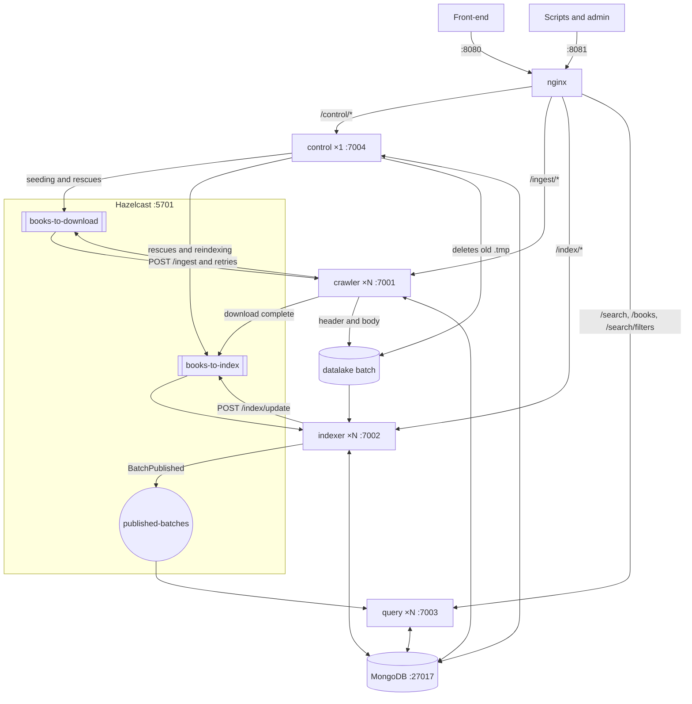

# Query Tarantino · Stage 2 · SPEC

Version 1.1 · October 23, 2026

Stage 2 contracts. Everything shared by two or more modules has its literal name here and, in code, lives only in `common`. If something is not here, ask before inventing it.

- It replaces the Stage 1 `SPEC.md`, which was the cross-language contract and does not move to `stage_2`.
- The reasons behind each decision are in the Stage 2 plan, which the team keeps outside the repository. If the plan and this file disagree, this file wins and the plan gets fixed.
- A contract change goes in a separate PR reviewed by all four members. That PR bumps the version of this file and updates `common`, `api/openapi.yaml` and, when affected, the plan and the team's notes for each module, all at once. Nobody changes a contract inside the PR for their own service.

## 1. Scope and assumptions

`crawler` downloads books from Project Gutenberg, `indexer` indexes them in batches, `query` searches with TF-IDF and `control` seeds and reconciles. The services never call each other: they coordinate through Hazelcast, keep the texts in the datalake and the source of truth in MongoDB.

Everything runs on one machine with Docker Compose. The design depends on these assumptions, which Stage 3 will have to lift:

- Addresses are Compose service names on a single network, and nginx is the only entry point from the host.
- The datalake is a local volume, mounted at the same path in `crawler`, `indexer` and `control`.
- There is a single Hazelcast member: if it goes down, the queues are lost and `control` rebuilds them from Mongo.
- MongoDB is a single server without replicas. Every state change is a single-document write, with no transactions.
- All containers share the host clock. Expirations are compared with Mongo's time (`$$NOW`); the host clock is only used in logs and in the `mtime` of `.tmp` files.

## 2. Architecture

### 2.1 Diagram



The life of a book: `control` seeds it, `crawler` downloads and enqueues it, `indexer` publishes it in a batch and `query` shows it.

### 2.2 Modules

| Module | Responsibility | Deployment |
| --- | --- | --- |
| `common` | Shared contracts: names, enums, records, JSON, configuration, tokenizer, stopwords, datalake paths, languages, Problem Details, `/health`, transition logs and crash points; in Mongo, the client, the indexes, “Create the pointer”, “Create the state” and reading a book's state (§6.2) | Dependency of the others |
| `crawler` | Ingestion: consumes `books-to-download`, claims each book, downloads it from Gutenberg or the local mirror, writes header and body and enqueues it in `books-to-index` | N replicas |
| `indexer` | Indexing: groups `books-to-index` into batches, writes metadata and postings into the write generation, publishes the batch and notifies | N replicas |
| `query` | Search: keeps a snapshot of the published batches of the current generation and serves `/search`, `/books/{book_id}` and `/search/filters` | N replicas behind nginx |
| `control` | Seeds the candidates, reconciles expired leases and lost messages, drives rebuilds and cleans the datalake and old generations | One replica |
| `bench` | Load generator, result processing and XChart charts for the integration benchmarks | Not deployed |
| `checks` | Functional API checks (F4) against the running stack and against `api/openapi.yaml` | Not deployed |

### 2.3 Repository and owners

```text
stage_2/
├── SPEC.md, README.md
├── pom.xml                  parent: modules and every version
├── docker-compose.yml, Dockerfile, .gitignore
├── common/
├── services/
│   ├── crawler/
│   ├── indexer/
│   ├── query/
│   └── control/
├── bench/
├── checks/
├── api/openapi.yaml
├── nginx/nginx.conf
├── scripts/
│   ├── fill_cache.sh        from Stage 1
│   ├── bench/<experiment>.sh
│   └── recovery/<nn>-<row>.sh
├── workload/                sample_ids.txt, book_ids.txt, queries.txt, stopwords.txt, corpus.sha256
└── benchmarks/runs/<run_id>/
```

| Path | Owner |
| --- | --- |
| `services/crawler`, `docker-compose.yml`, `Dockerfile` | A |
| `services/indexer` | B |
| `services/query`, `nginx/`, `api/openapi.yaml`, `checks/` | C |
| `services/control`, `scripts/recovery/` | D |
| `bench/` | C, the load generator; D, the shared part and result processing |
| `scripts/bench/<experiment>.sh` | Whoever owns the experiment in the plan's split |
| `common`, `SPEC.md`, parent `pom.xml`, `workload/` | All four, in a separate PR |

- Dependency and plugin versions live only in the parent `pom.xml` (`dependencyManagement` and `pluginManagement`). The Hazelcast client uses the same version as the member image.
- `benchmarks/runs/` is versioned; `benchmarks/cache/`, `benchmarks/mirror/`, `benchmarks/tmp.noindex/`, `datalake/` and `target/` stay out of git, and so do the plan and the team's notes, which are shared outside it.

### 2.4 Docker Compose

- Services: `mongo`, `hazelcast`, `crawler`, `indexer`, `query`, `control` and `nginx`. None uses `container_name`, so that `docker compose up -d --scale crawler=3 --scale indexer=3 --scale query=2` works. `control` always has one replica.
- Only nginx publishes ports on the host: 8080 and 8081. For debugging, use `docker compose exec`.
- Pinned image versions, never `latest`: `mongo:7.0`, as in Stage 1; `hazelcast/hazelcast` with `HZ_CLUSTERNAME=tarantino`; `nginx`; and for the four services one shared `Dockerfile` on `eclipse-temurin:25-jre`, which copies the service jar and adds `curl` for the healthcheck, because the image does not ship it.
- Addresses: `TARANTINO_MONGO_URI=mongodb://mongo:27017/tarantino` and `TARANTINO_HAZELCAST=hazelcast:5701`.
- Volumes: the `datalake` volume at `/data/datalake` in `crawler`, `indexer` and `control`, with `TARANTINO_DATALAKE=/data/datalake`; `./workload`, read-only, at `/app/workload` in `indexer`, `query` and `control`, with `TARANTINO_WORKLOAD=/app/workload`. When the local mirror is used, `benchmarks/mirror/` is mounted read-only in `crawler` and `control`, and `TARANTINO_MIRROR` points to that path.
- The timing variables (§4.7) are defined once in a shared block and reach every service with the same values.
- Healthchecks: each service, `curl -fsS http://localhost:<port>/health`; `mongo`, `mongosh --quiet --eval "db.adminCommand('ping')"`.
- Startup: each service opens its HTTP port first and retries the connection to Mongo and Hazelcast without limit. Until it connects, `/health` answers `503` and it consumes no queues, so startup order does not matter.
- Services do not restart on their own (`restart: "no"`): the recovery tests decide when each one comes back.

## 3. Code

- Hexagonal architecture as in Stage 1: `model`, `ports`, `adapters` and `commands`, with each service's `Main` and factory wiring the pieces through constructors, without injection frameworks.
- `model` and `commands` do not import Javalin, the Mongo driver, `org.bson`, Hazelcast or HTTP clients.
- Each service defines its ports in its `ports` package, like `InvertedIndexStorage`, `MetadataStorage` or `DatalakeReader` in the Stage 1 `indexer`. `common` defines no ports.
- Mongo filters and pipelines live only in `adapters`. The writes used by several services are in `common` (§5.1); the rest, in the Mongo adapter of the service that performs them.
- Immutable records for messages, responses and the `query` snapshot; no `synchronized` and no locks on the `query` read path.
- Javalin handlers only validate, write state and enqueue: they never download or index.
- SOLID and KISS: no transactions, no brokers besides Hazelcast and no layers that a second use does not call for.

## 4. Shared contracts

### 4.1 Formats

- snake_case JSON in the API, in Mongo and in Hazelcast.
- ISO-8601 UTC dates with `Z`, like `2026-10-21T10:05:00Z`; they may carry a fraction of a second. In Mongo they are `Date`.
- `book_id` is a positive integer (`Int32` in Mongo). `batch_id` is an `ObjectId`, which travels in JSON as its 24 hexadecimal characters.
- There is a single `ObjectMapper`, the one in `TarantinoJson` in `common`: Jackson with `JavaTimeModule`, snake_case, dates as text and unknown fields ignored.

### 4.2 Hazelcast

Hazelcast runs as one member in its own container (cluster `tarantino`, port 5701) and the services connect as clients, which reconnect on their own if it goes down. Queues are `IQueue<String>` and the topic is an `ITopic<String>`, carrying `TarantinoJson` JSON, so the member does not need the classes. The names are in `HazelcastContracts` and the records in `common`.

| Name | Type | Message | Produced by | Consumed by |
| --- | --- | --- | --- | --- |
| `books-to-download` | Queue | `BookTask` | `control` (seeding, lost messages and expired downloads), `POST /ingest/{book_id}` and `crawler` when retrying a failed download | `crawler` workers |
| `books-to-index` | Queue | `BookTask` | `crawler` after a complete download, `POST /index/update/{book_id}` and `control` (lost messages, released books and reindexing) | `indexer`, in batches with `drainTo` |
| `published-batches` | Topic | `BatchPublished` | `indexer`, when publishing a batch | `query` replicas |

| Record | JSON |
| --- | --- |
| `BookTask(int bookId, Instant enqueuedAt)` | `{"book_id": 1342, "enqueued_at": "2026-10-21T10:05:00Z"}` |
| `BatchPublished(String batchId, int generation, int bookCount, Instant publishedAt)` | `{"batch_id": "6716f0c2a1b2c3d4e5f60718", "generation": 1, "book_count": 100, "published_at": "2026-10-21T10:06:00Z"}` |

- Hazelcast is not the source of truth: a message can be lost or repeated, and no ordering is assumed.
- A message is acknowledged by the claim in Mongo. If the conditional write does not match, the message is a duplicate or stale and is simply dropped.
- `BookTask.enqueued_at` is the producer's time (`Instant.now()`) and is only used to measure queue wait (§4.8). Rescuing lost messages uses `book_states.enqueued_at`, which is written with `$$NOW` (§5.3).
- `BatchPublished` copies the batch as “Publish a batch” left it (§5.1): `book_count` is the size of its `book_ids`, at least 1, and `published_at` is its `published_at`.
- If enqueuing fails after writing to Mongo, the book stays in its state and `control` enqueues it again (§5.3).
- A lost `BatchPublished` does not matter: `query` re-reads the batches every `TARANTINO_SNAPSHOT_SECONDS`. Generation switches are not announced.

### 4.3 Mongo collections

The database is the one in the path of `TARANTINO_MONGO_URI`, or `tarantino`, as in Stage 1. `book_states` and `index_state` are single collections; the other three carry their generation suffix, `_g<n>` (`postings_g1`), and their names always come from `common`. The state collection is not called `books` because in Stage 1 that collection held the metadata.

**`book_states`**: one document per book.

| Field | Type | Content |
| --- | --- | --- |
| `_id` | Int32 | `book_id` |
| `status` | String | Book state (§4.5) |
| `attempts` | Int32 | Downloads started |
| `claim_id` | String | Lease UUID; only in `DOWNLOADING` |
| `lease_until` | Date | Lease end; only in `DOWNLOADING` |
| `batch_id` | ObjectId | Batch that claimed it; only in `INDEXING` and `PUBLISHED` |
| `generation` | Int32 | Generation of the last batch that claimed it; absent until then |
| `last_error` | String or null | Last error (§4.5), also while the book is retried; `null` after a successful download and when a `FAILED` book is retried |
| `enqueued_at` | Date | Last time it was put on a queue, with `$$NOW` |
| `downloaded_at`, `published_at` | Date | When it last reached that state; absent until then |
| `updated_at` | Date | Last write |

**`metadata_g<n>`**: one document per book.

| Field | Type | Content |
| --- | --- | --- |
| `_id` | Int32 | `book_id` |
| `title` | String or null | `Title:` from the header |
| `author` | String or null | `Author:` as it comes |
| `author_terms` | [String] | Author words through the tokenizer, without repeats |
| `languages` | [String] | ISO 639-1 codes, in header order; a name without a code does not appear here |
| `language_names` | [String] | Names as they come (`English`), including those without a code |
| `year` | Int32 or null | Year from `Release date:`, never confused with the number in `[eBook #1342]` |
| `original_year` | Int32 or null | Year from `Original publication:` |

**`postings_g<n>`**: one document per term and batch. The field is called `term`, as in Stage 1, never `word`.

| Field | Type | Content |
| --- | --- | --- |
| `_id` | ObjectId | Automatic |
| `term` | String | Tokenizer term |
| `batch_id` | ObjectId | Batch that wrote it |
| `book_ids` | [Int32] | Books of the batch that contain the term, ascending |
| `tfs` | [Int32] | Term frequency in each book, at the same position as in `book_ids` |

**`batches_g<n>`**: one document per batch.

| Field | Type | Content |
| --- | --- | --- |
| `_id` | ObjectId | `batch_id`, created by the indexer |
| `status` | String | Batch state (§4.5) |
| `claim_id` | String | UUID of the indexer's lease |
| `owner` | String | Hostname of the replica writing it, for the logs |
| `lease_until` | Date | Lease end; only in `WRITING` |
| `book_ids` | [Int32] | Empty in `WRITING`; once published, the final books, ascending and at least one |
| `opened_at`, `published_at`, `abandoned_at` | Date | When it reached that state; absent until then |

**`index_state`**: two documents.

| `_id` | Fields | Content |
| --- | --- | --- |
| `"current"` | `generation` Int32, `switched_at` Date | Generation served by `query`. It starts at 1, and any service creates it at startup with “Create the pointer” |
| `"rebuild"` | `target_generation` Int32, `status` String, `requested_at` Date, `switched_at` Date or null | Rebuild in progress, or the last one finished; `switched_at` is `null` while `RUNNING` |

### 4.4 Indexes

Each service ensures at startup the indexes of the collections it uses, and the indexer ensures those of a generation before its first write to it. The definitions are in `common` and `createIndex` is idempotent.

| Collection | Index | Purpose |
| --- | --- | --- |
| `book_states` | `{status: 1, enqueued_at: 1}` | Lost messages and `GET /ingest/list` |
| `book_states` | `{status: 1, lease_until: 1}` | Downloads with an expired lease |
| `book_states` | `{batch_id: 1}` | Books of a batch when publishing or releasing it |
| `book_states` | `{generation: 1, status: 1}` | Reindexing and books pending in a rebuild |
| `metadata_g<n>` | `{author_terms: 1}`, multikey | `author` filter |
| `metadata_g<n>` | `{languages: 1, year: 1}`, multikey | `language` filter, alone or with `year` |
| `metadata_g<n>` | `{year: 1}` | `year` filter alone |
| `postings_g<n>` | `{term: 1, batch_id: 1}`, unique | `query` reads and indexer upserts |
| `postings_g<n>` | `{batch_id: 1}` | Deleting the postings of an abandoned batch |
| `batches_g<n>` | `{status: 1, lease_until: 1}` | Published batches and expired batches |
| `index_state` | `_id` only | |

### 4.5 States and codes

They are written in uppercase and only these. In Java they are `common` enums, and in Mongo and JSON they travel as their name.

| Book (`book_states.status`) | Meaning | Written by |
| --- | --- | --- |
| `QUEUED` | Waiting in `books-to-download` | `control` when seeding and when releasing an expired download; `POST /ingest`; `crawler` when retrying a failed download |
| `DOWNLOADING` | Claimed by a `crawler` worker | `crawler` |
| `DOWNLOADED` | In the datalake, waiting for a batch | `crawler`; `control` when releasing a batch's books or reindexing |
| `INDEXING` | Claimed by a `WRITING` batch | `indexer` |
| `PUBLISHED` | Searchable in its batch's generation | `indexer`; `control` when completing a publication |
| `FAILED` | No more retries; the reason is in `last_error` | `crawler`, `indexer` or `control` |

| Batch (`batches_g<n>.status`) | Meaning | Written by |
| --- | --- | --- |
| `WRITING` | The indexer is writing its metadata and postings | `indexer`, when opening it |
| `PUBLISHED` | Visible to `query`; never changes again | `indexer`, with its lease alive |
| `ABANDONED` | Its lease expired; it will never be seen | `control` |

The rebuild (`index_state.rebuild.status`) only has `RUNNING`, written by `POST /index/rebuild`, and `DONE`, written by `control`.

| `last_error` (`BookErrorCode`) | Written by | What happens |
| --- | --- | --- |
| `NOT_FOUND` | `crawler` | Gutenberg or the mirror does not have the book: `FAILED` without retries |
| `MISSING_MARKERS` | `crawler` | The text lacks the start and end markers: `FAILED` without retries |
| `NETWORK_ERROR` | `crawler` | The network or the mirror read failed: `QUEUED` up to `TARANTINO_MAX_ATTEMPTS` |
| `STORAGE_ERROR` | `crawler` | Writing to the datalake failed: `QUEUED` up to `TARANTINO_MAX_ATTEMPTS` |
| `LEASE_EXPIRED` | `control` | A download lease expired: `QUEUED`, or `FAILED` if `TARANTINO_MAX_ATTEMPTS` were already used |
| `NOT_IN_DATALAKE` | `indexer` | The claimed book is missing its header or body: `FAILED`; `POST /ingest` retries it |

| Error `code` (`ProblemCode`) | HTTP | When |
| --- | --- | --- |
| `MISSING_PARAMETER` | 400 | `q` is missing or blank |
| `INVALID_PARAMETER` | 400 | A malformed or out-of-range parameter or id |
| `BOOK_NOT_FOUND` | 404 | The book is not in `book_states` or, in `query`, not in the snapshot |
| `NOT_DOWNLOADED` | 409 | `POST /index/update` for a book that is not downloaded |
| `DEPENDENCY_UNAVAILABLE` | 503 | Mongo or Hazelcast do not answer, or `query` has no snapshot yet |

### 4.6 Datalake

- Stage 1 `batch` layout: `<TARANTINO_DATALAKE>/<book_id / 1000>/<book_id>.header.txt` and `<book_id>.body.txt`, with integer division. Book 1342 goes in `datalake/1/` and book 84 in `datalake/0/`. The paths come from `DatalakePaths`, in `common`.
- Each file is written to `<final name>.<uuid>.tmp`, in the same directory, and renamed with `Files.move(tmp, final, ATOMIC_MOVE)`, which on Linux replaces any existing file. For example, `datalake/1/1342.body.txt.3f2b8c1e-9a4d-4c2e-8f1a-6b7d5e9c0a12.tmp`. Header first and body second, as in Stage 1.
- A book is in the datalake when its final header and body exist; since the body is written last, checking the body is enough. A header without a body does not count and is overwritten on retry.
- A `.tmp` only exists while it is being written, because the whole book is downloaded into memory before saving. That is why a `.tmp` whose `mtime` is older than `TARANTINO_TMP_MAX_AGE_SECONDS` is an orphan.
- Only `control` deletes, every `TARANTINO_CLEANUP_SECONDS`, and only those `.tmp` files. `crawler` never deletes anything, and `indexer` only reads.
- No datalake path is ever exposed through the API.

### 4.7 Configuration

Every variable has a default that works locally, and `docker-compose.yml` sets the container addresses. `TarantinoConfig`, in `common`, reads and validates every variable at startup, in every service. An invalid configuration stops the service with a message that names the variable, as in Stage 1.

| Variable | Default | Used by | Purpose |
| --- | --- | --- | --- |
| `TARANTINO_PORT` | 7001, 7002, 7003 and 7004 | All | HTTP port of `crawler`, `indexer`, `query` and `control` |
| `TARANTINO_HTTP_THREADS` | Javalin's | All | Maximum request threads (8 to 250 in Javalin 6) |
| `TARANTINO_MONGO_URI` | `mongodb://localhost:27017` | All | MongoDB, as in Stage 1 |
| `TARANTINO_HAZELCAST` | `localhost:5701` | All | Hazelcast members, comma-separated |
| `TARANTINO_HAZELCAST_CLUSTER` | `tarantino` | All | Cluster name |
| `TARANTINO_DATALAKE` | `datalake` | `crawler`, `indexer`, `control` | Datalake root, the same path in every container |
| `TARANTINO_WORKLOAD` | `workload` | `indexer`, `query`, `control` | `workload/` directory: `stopwords.txt` and the id lists |
| `TARANTINO_MIRROR` | None | `crawler`, `control` | Path of a local Gutenberg mirror (`<id>/pg<id>.txt`), as in Stage 1; without it, `crawler` downloads over HTTP |
| `TARANTINO_CANDIDATES` | `sample_ids.txt` | `control` | Books seeded by `control`: a file in `TARANTINO_WORKLOAD` with one id per line, or `mirror` for every book in the local mirror |
| `TARANTINO_PARALLEL_DOWNLOADS` | 8 | `crawler` | Download workers per replica, as in Stage 1 |
| `TARANTINO_MAX_ATTEMPTS` | 3 | `crawler`, `control` | Downloads of a book before `FAILED` |
| `TARANTINO_INDEX_BATCH` | 100 | `indexer` | Books per batch, as in Stage 1 (1 = book by book) |
| `TARANTINO_BATCH_TIMEOUT_SECONDS` | 30 | `indexer` | Maximum wait, from the first book, to close a batch |
| `TARANTINO_LEASE_SECONDS` | 60 | `crawler`, `indexer`, `control` | Duration of a book or batch lease |
| `TARANTINO_HEARTBEAT_SECONDS` | 20 | `crawler`, `indexer` | How often a lease is renewed |
| `TARANTINO_RECONCILE_SECONDS` | 30 | `control` | How often it reconciles |
| `TARANTINO_REQUEUE_SECONDS` | 120 | `control` | Age of `enqueued_at` to requeue when the queue is empty |
| `TARANTINO_GC_SECONDS` | 600 | `control` | Wait before deleting an `ABANDONED` batch or an old generation |
| `TARANTINO_TMP_MAX_AGE_SECONDS` | 600 | `control` | Age after which a `.tmp` is an orphan |
| `TARANTINO_CLEANUP_SECONDS` | 3600 | `control` | How often it cleans the datalake |
| `TARANTINO_SNAPSHOT_SECONDS` | 5 | `query` | Periodic snapshot refresh |
| `TARANTINO_CORS_ORIGIN` | `*` | `query` | Origin `query` allows through CORS |
| `TARANTINO_CRASH_AT` | None | `crawler`, `indexer` | Recovery tests only: point from §8 where the service stops |

Besides every number being a positive integer, these are required:

- `TARANTINO_HEARTBEAT_SECONDS ≤ TARANTINO_LEASE_SECONDS / 3`.
- `TARANTINO_GC_SECONDS ≥ 10 × TARANTINO_LEASE_SECONDS` and `TARANTINO_TMP_MAX_AGE_SECONDS ≥ 10 × TARANTINO_LEASE_SECONDS`.
- `TARANTINO_REQUEUE_SECONDS > TARANTINO_BATCH_TIMEOUT_SECONDS`.
- `TARANTINO_CRASH_AT`, if set, is a §8 point of the service being started.
- `TARANTINO_CANDIDATES=mirror` requires `TARANTINO_MIRROR`.

`TARANTINO_DATALAKE_LAYOUT`, `TARANTINO_INDEX`, `TARANTINO_METADATA`, `TARANTINO_DATAMARTS` and `TARANTINO_CONTROL` are gone: there are no alternative structures or state files anymore.

### 4.8 Transition logs

Each service writes one line for every book or batch state change it achieves (§5.1), and `control` also writes one for every message it requeues, with equal `from` and `to`. The line is written by `TransitionLog`, in `common`, at INFO level and with these keys in this order; `-` marks what does not apply:

```text
transition entity=book id=1342 from=QUEUED to=DOWNLOADING batch_id=- generation=- enqueued_at=2026-10-21T10:05:00Z at=2026-10-21T10:05:02.481Z replica=3f2b8c1e9a4d
```

- `entity` is `book` or `batch`, and `id` is the `book_id` or the `batch_id`. In a batch line, `batch_id` is `-`.
- `from` and `to` are states from §4.5; `from` is `-` when the document is created.
- `enqueued_at` is the one from the `BookTask` when the transition comes from a message (claiming a download or a book for a batch); otherwise, `-`. When a batch drained several messages for the same book, it is the earliest of them.
- `at` is `Instant.now()` when the write finishes, and `replica` is the container hostname.
- It is only written when the conditional write matches. `bench` derives `coordination.csv` (§9) from these lines, searching from `transition`, because `slf4j-simple` puts its prefix in front.

## 5. Conditional writes and reconciliation

### 5.1 Conditional writes

Dates compared across processes use the Mongo server's time (`$$NOW`), never the process's, so changes are update pipelines. In the table, `L` is `TARANTINO_LEASE_SECONDS` in milliseconds, `R` is `TARANTINO_REQUEUE_SECONDS` in milliseconds, `M` is `TARANTINO_MAX_ATTEMPTS`, `C` is the lease UUID (a new one when claiming; in `control`, the `claim_id` it read), `B` is the `batch_id`, `w` is the write generation, `g` is `current.generation` and `t` is `rebuild.target_generation`.

- Whoever fails its write does not retry: it leaves the work to whoever succeeded or to `control`.
- When the next step depends on how the document ended up, use `findOneAndUpdate` with `ReturnDocument.AFTER`, never a separate `find`.
- The ones marked *(common)* live in `common`; the rest, in the Mongo adapter of the service that performs them.
- Each one has a test with two claimants at once, on Testcontainers MongoDB.

| Operation | Who | Filter | Change | If it does not match |
| --- | --- | --- | --- | --- |
| Create the pointer *(common)* | All, at startup | `{_id: "current"}`, with upsert | `[{$set: {generation: {$ifNull: ["$generation", 1]}, switched_at: {$ifNull: ["$switched_at", "$$NOW"]}}}]` | It existed: no change |
| Create the state *(common)* | `control` when seeding; `POST /ingest` | `{_id: id}`, with upsert | `[{$set: {status: {$ifNull: ["$status", "QUEUED"]}, attempts: {$ifNull: ["$attempts", 0]}, enqueued_at: {$ifNull: ["$enqueued_at", "$$NOW"]}, updated_at: {$ifNull: ["$updated_at", "$$NOW"]}}}]`; if `upsertedId` is not null, `BookTask` to `books-to-download` | It existed: not enqueued |
| Retry a `FAILED` book | `POST /ingest` | `{_id: id, status: "FAILED"}` | `[{$set: {status: "QUEUED", attempts: 0, last_error: null, enqueued_at: "$$NOW", updated_at: "$$NOW"}}]`; then `BookTask` to `books-to-download` | No longer `FAILED`: its state is returned |
| Claim a book | `crawler` | `{_id: id, status: "QUEUED"}` | `[{$set: {status: "DOWNLOADING", claim_id: C, lease_until: {$add: ["$$NOW", L]}, attempts: {$add: ["$attempts", 1]}, updated_at: "$$NOW"}}]` | Duplicate or stale message: dropped |
| Renew a book | `crawler`, every `HEARTBEAT` | `{_id: id, status: "DOWNLOADING", claim_id: C}` | `[{$set: {lease_until: {$add: ["$$NOW", L]}}}]` | Lease lost: leaves the book without marking anything |
| Finish a download | `crawler` | `{_id: id, status: "DOWNLOADING", claim_id: C}` | `[{$set: {status: "DOWNLOADED", downloaded_at: "$$NOW", enqueued_at: "$$NOW", updated_at: "$$NOW", last_error: null}}, {$unset: ["claim_id", "lease_until"]}]`; then `BookTask` to `books-to-index` | Does not enqueue: whoever claims it next will find it in the datalake |
| Fail a download | `crawler` | `{_id: id, status: "DOWNLOADING", claim_id: C}`, with `findOneAndUpdate` | `[{$set: {status: {$cond: [{$and: [E, {$lt: ["$attempts", M]}]}, "QUEUED", "FAILED"]}, last_error: code, updated_at: "$$NOW"}}, {$set: {enqueued_at: {$cond: [{$eq: ["$status", "QUEUED"]}, "$$NOW", "$enqueued_at"]}}}, {$unset: ["claim_id", "lease_until"]}]`, with `E` = `true` for `NETWORK_ERROR` and `STORAGE_ERROR` and `false` for `NOT_FOUND` and `MISSING_MARKERS`; if it ends `QUEUED`, `BookTask` to `books-to-download` | Lease lost: nothing |
| Release an expired download | `control` | `{_id: id, status: "DOWNLOADING", claim_id: C, $expr: {$lte: ["$lease_until", "$$NOW"]}}`, with `findOneAndUpdate` | `[{$set: {status: {$cond: [{$lt: ["$attempts", M]}, "QUEUED", "FAILED"]}, last_error: "LEASE_EXPIRED", updated_at: "$$NOW"}}, {$set: {enqueued_at: {$cond: [{$eq: ["$status", "QUEUED"]}, "$$NOW", "$enqueued_at"]}}}, {$unset: ["claim_id", "lease_until"]}]`; if it ends `QUEUED`, `BookTask` to `books-to-download` | The worker renewed or finished: nothing |
| Requeue a lost message | `control`, with the queue empty | `{_id: id, status: S, $expr: {$lte: ["$enqueued_at", {$subtract: ["$$NOW", R]}]}}`, with `S` = `QUEUED` for `books-to-download` and `DOWNLOADED` for `books-to-index` | `[{$set: {enqueued_at: "$$NOW", updated_at: "$$NOW"}}]`; then `BookTask` to that queue | Someone moved or enqueued it: nothing |
| Open a batch | `indexer` | `{_id: B}` in `batches_g<w>`, with upsert | `[{$set: {status: "WRITING", claim_id: C, owner: host, lease_until: {$add: ["$$NOW", L]}, book_ids: [], opened_at: "$$NOW"}}]` | Cannot happen: `B` is new |
| Claim its books | `indexer` | `updateMany` with `{_id: {$in: ids}, status: "DOWNLOADED"}` | `[{$set: {status: "INDEXING", batch_id: B, generation: w, updated_at: "$$NOW"}}]`; then `find({batch_id: B, status: "INDEXING"})` gives the batch's books | The others are ignored; if none is left, it stops renewing the batch and `control` abandons it when it expires |
| Renew a batch | `indexer`, every `HEARTBEAT` | `{_id: B, status: "WRITING", claim_id: C}` | `[{$set: {lease_until: {$add: ["$$NOW", L]}}}]` | Lease lost: stops writing |
| Fail at indexing | `indexer` | `{_id: id, status: "INDEXING", batch_id: B}` | `[{$set: {status: "FAILED", last_error: "NOT_IN_DATALAKE", updated_at: "$$NOW"}}, {$unset: "batch_id"}]`, keeping `generation`; the book leaves the batch, and if none is left the batch is not published, as in “Claim its books” | No longer in this batch: nothing |
| Publish a batch | `indexer` | `{_id: B, status: "WRITING", claim_id: C, $expr: {$gt: ["$lease_until", "$$NOW"]}}`, with `findOneAndUpdate` | `[{$set: {status: "PUBLISHED", published_at: "$$NOW", book_ids: books}}, {$unset: "lease_until"}]`, with `books` never empty; then `updateMany({batch_id: B, status: "INDEXING"}, [{$set: {status: "PUBLISHED", published_at: "$$NOW", updated_at: "$$NOW"}}])` and `BatchPublished` from the document it returns (§4.2) | Lease lost: neither marks books nor notifies |
| Abandon a batch | `control` | `{_id: B, status: "WRITING", $expr: {$lte: ["$lease_until", "$$NOW"]}}` | `[{$set: {status: "ABANDONED", abandoned_at: "$$NOW"}}, {$unset: "lease_until"}]` | It was published or renewed: untouched |
| Release its books | `control` | `{_id: id, status: "INDEXING", batch_id: B}`, with `B` `ABANDONED` or without a document | `[{$set: {status: "DOWNLOADED", enqueued_at: "$$NOW", updated_at: "$$NOW"}}, {$unset: "batch_id"}]`, keeping `generation`; then `BookTask` to `books-to-index` | Someone changed it first: nothing |
| Complete a publication | `control` | `{_id: id, status: "INDEXING", batch_id: B}`, with `B` `PUBLISHED` | `[{$set: {status: "PUBLISHED", published_at: "$$NOW", updated_at: "$$NOW"}}]` | Already done |
| Reindex into another generation | `control` | `{_id: id, status: "PUBLISHED", generation: {$lt: w}}` | `[{$set: {status: "DOWNLOADED", enqueued_at: "$$NOW", updated_at: "$$NOW"}}, {$unset: "batch_id"}]`, keeping `generation`; then `BookTask` to `books-to-index` | Already reindexed: nothing |
| Open a rebuild | `POST /index/rebuild` | `{_id: "rebuild", status: {$ne: "RUNNING"}}`, with upsert | `[{$set: {target_generation: g + 1, status: "RUNNING", requested_at: "$$NOW", switched_at: null}}]` | One is already running: the upsert fails with code 11000 and the existing one is returned (§5.4) |
| Switch generation | `control` | `{_id: "current", generation: t - 1}` | `[{$set: {generation: t, switched_at: "$$NOW"}}]` | Someone already switched it |
| Finish the rebuild | `control` | `{_id: "rebuild", status: "RUNNING", target_generation: t}` | `[{$set: {status: "DONE", switched_at: "$$NOW"}}]` | Already finished |

### 5.2 Why a book never ends up in two published batches

Only a `DOWNLOADED` book can be claimed. An `INDEXING` book only goes back to `DOWNLOADED` once `control` has abandoned its batch, and an `ABANDONED` batch cannot be published, because publishing requires `WRITING`. So each book is in at most one live batch and, therefore, in a single published batch per generation. Even so, `query` deduplicates by `book_id` when reading postings and logs an error if it finds a repeat.

### 5.3 What `control` does

**At startup**, after “Create the pointer” and ensuring its indexes, it seeds: it reads the candidates from `TARANTINO_CANDIDATES`, applies “Create the state” to each one and enqueues only the ones it created, without calling `crawler` or `indexer`. Then it reconciles for the first time.

**Reconciliation**, every `TARANTINO_RECONCILE_SECONDS` and in this order. Each step is idempotent, and every write of `control` that enqueues, seeding included, sends its `BookTask` right after it: a `control` crash halfway leaves at most books in their new state without their message, which step 4 requeues.

1. Expired downloads: find `{status: "DOWNLOADING", $expr: {$lte: ["$lease_until", "$$NOW"]}}` and apply “Release an expired download” to each.
2. Expired batches: in every `batches_g<k>` that exists, find the `WRITING` ones whose `lease_until` has passed and apply “Abandon a batch” to each. All generations are checked so that an old batch does not wait for its generation's `drop`.
3. `INDEXING` books: look up each one's batch in `batches_g<book's generation>`. If it is `WRITING`, leave it; if it is `ABANDONED` or missing, “Release its books”; if it is `PUBLISHED`, “Complete a publication”.
4. Lost messages: if `books-to-download` is empty, apply “Requeue a lost message” to the `QUEUED` books whose `enqueued_at` is older than `$$NOW − R`; if `books-to-index` is empty, do the same with the `DOWNLOADED` books. This also rebuilds the queues if Hazelcast restarts. That is why `REQUEUE > BATCH_TIMEOUT`: an indexer holds the messages of its batch for up to `BATCH_TIMEOUT` before claiming them.
5. Abandoned batches: for each `ABANDONED` batch whose `abandoned_at` is older than `$$NOW − TARANTINO_GC_SECONDS`, delete its postings (`deleteMany({batch_id: B})` in `postings_g<k>`). The batch stays `ABANDONED` until its generation is dropped, so this step repeats on every reconciliation and also deletes the postings that a zombie indexer (§8) writes after the first deletion. Metadata is not deleted: it is per book, it is overwritten when the book is published in another batch and `query` only reads the metadata of its snapshot.
6. Generations:
   1. Apply “Reindex into another generation” to every `PUBLISHED` book with `generation < w`, where `w` is the target if a rebuild is `RUNNING` and `current.generation` otherwise. Outside a rebuild, it only finds books from an indexer that read the generation right before a switch.
   2. With a `RUNNING` rebuild targeting `t`: if `current.generation` is `t − 1` and the condition in step 4 of §5.4 holds, apply “Switch generation” and then “Finish the rebuild”. If `current.generation` is already `t` because `control` crashed between the two, only “Finish the rebuild”.
   3. If `current.switched_at` is older than `$$NOW − TARANTINO_GC_SECONDS`, `drop` the collections `metadata_g<k>`, `postings_g<k>` and `batches_g<k>` of every generation `k < current.generation`.

**Datalake cleanup**, every `TARANTINO_CLEANUP_SECONDS`: delete the `.tmp` files whose `mtime` is older than `TARANTINO_TMP_MAX_AGE_SECONDS`, compared with the container clock, which is the host's. Never delete headers or bodies.

### 5.4 Rebuild

A generation pointer is used, not `renameCollection`: renaming three collections is not atomic, and between one rename and the next `query` would see postings from one generation with batches from another. Switching the pointer is a single write.

1. `POST /index/rebuild` reads `g = current.generation` and applies “Open a rebuild”. If one is already running, the filter `{_id: "rebuild", status: {$ne: "RUNNING"}}` does not match and MongoDB tries to insert another document with the same `_id`, which fails with code 11000 (Duplicate Key). The driver throws a `MongoWriteException` with `updateOne` and a `MongoCommandException` with `findOneAndUpdate`, and both extend `MongoServerException`. The service catches `MongoServerException` and, if `getCode() == 11000`, reads the existing document in `index_state` and answers `202` with its current state instead of failing; with any other code, the exception propagates.
2. The write generation is `target_generation` while a rebuild is `RUNNING`, and `current.generation` otherwise. Each indexer reads it before opening each batch and ensures that generation's indexes before its first write to it.
3. On every reconciliation, `control` sends back to `DOWNLOADED`, and enqueues, every `PUBLISHED` book with `generation < target_generation`, including those that an old batch that was already open publishes late.
4. When no book is left with `generation < target_generation` except the `FAILED` ones, and no book with `generation == target_generation` is in state `DOWNLOADED` or `INDEXING`, `control` switches the pointer with “Switch generation” and marks the rebuild with “Finish the rebuild”. Books without `generation` (never indexed) do not count.
5. `query` sees the new generation on its next refresh and swaps its whole snapshot. While the rebuild runs it keeps serving the old generation, and new books are not visible until the switch.
6. Once `TARANTINO_GC_SECONDS` have passed since `current.switched_at`, `control` `drop`s the collections of the old generations.

## 6. HTTP API

`api/openapi.yaml` is derived from this section and its `info.version` follows this file's version. If the two disagree, the OpenAPI gets fixed.

### 6.1 Entry ports and endpoints

nginx has two entry ports. 8080 is only for the front-end and routes `/search`, `/search/filters` and `/books/` to the `query` replicas; any other path gives `404`. 8081 is for operations and routes `/ingest/` to `crawler`, `/index/` to `indexer` and `/control/` to `control`, without rewriting paths. nginx must spread requests across all replicas even when their number changes: with `resolver 127.0.0.11 valid=5s` and the address in a variable, or by restarting it after each `--scale`.

There are no internal endpoints between services: that coordination goes through Hazelcast (§4.2), which is documented separately.

| Inventory | Service (port) | nginx port | Method and path | Consumer | Responses |
| --- | --- | --- | --- | --- | --- |
| Front-end | `query` (7003) | 8080 | `GET /search` | Front-end | `200`, `400`, `503` |
| Front-end | `query` (7003) | 8080 | `GET /books/{book_id}` | Front-end | `200`, `400`, `404`, `503` |
| Front-end | `query` (7003) | 8080 | `GET /search/filters` | Front-end | `200`, `503` |
| Operational | `crawler` (7001) | 8081 | `POST /ingest/{book_id}` | Load and admin scripts | `202`, `200`, `400`, `503` |
| Operational | `crawler` (7001) | 8081 | `GET /ingest/status/{book_id}` | Whoever got a `202`; checks | `200`, `400`, `404`, `503` |
| Operational | `crawler` (7001) | 8081 | `GET /ingest/list` | Checks | `200`, `503` |
| Operational | `indexer` (7002) | 8081 | `POST /index/update/{book_id}` | Admin | `202`, `200`, `400`, `404`, `409`, `503` |
| Operational | `indexer` (7002) | 8081 | `GET /index/status/{book_id}` | Whoever got a `202` | `200`, `400`, `404`, `503` |
| Operational | `indexer` (7002) | 8081 | `POST /index/rebuild` | Admin | `202`, `503` |
| Operational | `indexer` (7002) | 8081 | `GET /index/status` | Admin and benchmarks | `200`, `503` |
| Operational | `control` (7004) | 8081 | `GET /control/status` | Admin and benchmarks | `200`, `503` |
| Health | All, on their own port | None | `GET /health` | Compose healthchecks | `200`, `503` |

Besides the responses in the table, every endpoint answers `500` to an unexpected exception, as §6.6 says.

### 6.2 Book state

`GET /ingest/status/{book_id}` and `GET /index/status/{book_id}` return the same thing, read from `book_states`, and it is also the body of every `200` and every `202` from `POST /ingest/{book_id}` and `POST /index/update/{book_id}`:

```json
{"book_id": 1342, "status": "INDEXING", "attempts": 1, "last_error": null, "updated_at": "2026-10-21T10:05:00Z"}
```

An id that is not a positive integer gives `400` (`INVALID_PARAMETER`, `parameter: "book_id"`), and on the `GET`s a book without a document gives `404`. Every `202` carries a `Location` pointing to the book's state: `/ingest/status/{book_id}` from `/ingest` and `/index/status/{book_id}` from `/index/update`. `200` responses carry no `Location`.

| Request and book state | Response |
| --- | --- |
| `POST /ingest`, no document | “Create the state” and enqueue: `202` with the state (`QUEUED`) |
| `POST /ingest`, in `FAILED` | “Retry a `FAILED` book”: `202` with the state (`QUEUED`, `attempts` back to 0) |
| `POST /ingest`, in `QUEUED` or `DOWNLOADING` | `202` with its state, without enqueuing it again |
| `POST /ingest`, in `DOWNLOADED`, `INDEXING` or `PUBLISHED` | `200` with its state |
| `POST /index/update`, no document | `404` (`BOOK_NOT_FOUND`) |
| `POST /index/update`, in `QUEUED`, `DOWNLOADING` or `FAILED` | `409` (`NOT_DOWNLOADED`); for a `FAILED` book, the way forward is `POST /ingest` |
| `POST /index/update`, in `DOWNLOADED` | `202` with its state, and a `BookTask` to `books-to-index`: a duplicate does no harm |
| `POST /index/update`, in `INDEXING` | `202` with its state, without enqueuing |
| `POST /index/update`, in `PUBLISHED` | `200` with its state |

`POST /ingest/{book_id}` follows this order: “Create the state”; if it already existed, “Retry a `FAILED` book”; if that does not match either, it reads the state and answers according to the table. If Hazelcast fails after writing to Mongo, it answers `503`: the book stays `QUEUED` and `control` enqueues it (§5.3).

### 6.3 `GET /search`

`GET /search?q={terms}&author={name}&language={code}&year={YYYY}&offset={n}&limit={n}`. With filters, the ids come from the `metadata_g<n>` indexes and are intersected with the postings; without filters, only the metadata of the page is read.

| Parameter | Rule |
| --- | --- |
| `q` | Required. It is tokenized with the `common` tokenizer, the same one used for indexing, and books must contain every word. If missing or blank, `400` (`MISSING_PARAMETER`); if it only has stopwords or no words, `200` with no results. |
| `author` | Every author word, with the same tokenizer, must be in `author_terms`: `austen` finds “Jane Austen”. If no word is left, `400`. |
| `language` | Two-letter lowercase ISO 639-1 code (`^[a-z]{2}$`); a book with several languages matches any of them. Malformed, `400`; no books, empty `200`. |
| `year` | Four digits (`^[0-9]{4}$`), equal to the Gutenberg publication year (`year`). Malformed, `400`. |
| `offset`, `limit` | Integers; `0` and `20` by default, `offset ≥ 0` and `limit` from 1 to 100. Out of range or non-numeric, `400`. |
| Order | Descending TF-IDF, summing `(1 + ln tf) × ln(N / df)` per word; ties broken by ascending `book_id` (§7). |
| `total` | Matches with the filters applied, not just those on the page. |

An optional parameter that is empty or only whitespace (`author=`) counts as absent; any other value must follow its rule exactly as received, without trimming. The parameters are checked in the table's order, `q`, `author`, `language`, `year`, `offset` and `limit`: the first one that fails gives the `400`, naming it in `parameter`, and the search only runs once all of them are valid. So `q` with only stopwords and an `author` with no words gives `400`, not an empty `200`.

```json
{
  "query": "pride prejudice",
  "filters": {"author": "austen", "language": "en"},
  "total": 1,
  "offset": 0,
  "limit": 20,
  "results": [
    {"book_id": 1342, "title": "Pride and Prejudice", "author": "Jane Austen", "language": "en", "year": 1998}
  ]
}
```

- `query` is `q` as received, and `filters` the filters present as received, with `year` as a number; without filters, `{}`.
- `offset` and `limit` are the ones applied, including when they are the defaults.
- Each result carries `book_id`, `title`, `author`, `language` and `year`, never the datalake path. `language` is the first code in `languages`, or `null`.

### 6.4 Books and filters

**`GET /books/{book_id}`.** `200` if the book is in a published batch of the snapshot, `404` (`BOOK_NOT_FOUND`) otherwise, `400` if the id is not a positive integer and `503` without a snapshot. It carries the fields of a search result plus `languages` and `original_year`.

```json
{"book_id": 1342, "title": "Pride and Prejudice", "author": "Jane Austen", "language": "en", "languages": ["en"], "year": 1998, "original_year": null}
```

**`GET /search/filters`.** It takes no parameters, so it answers `200` or `503`. It is computed once per snapshot and only with the snapshot's books. `languages` goes from most to fewest books, with the name from the `common` language table; `total_books` is `N`. With no books, `languages` is `[]` and `min` and `max` are `null`.

```json
{"languages": [{"code": "en", "name": "English", "books": 2380}, {"code": "fr", "name": "French", "books": 95}], "years": {"min": 1971, "max": 2026}, "total_books": 2800}
```

### 6.5 Operational endpoints

| Request | Response |
| --- | --- |
| `GET /ingest/list` | `{"count": 3, "books": [5, 17, 1342]}`: books in `DOWNLOADED`, `INDEXING` or `PUBLISHED`, ascending |
| `POST /index/rebuild` | `202` with `{"generation": 1, "target_generation": 2, "status": "RUNNING"}` and `Location: /index/status`; if one is already running, `202` with the existing one |
| `GET /index/status` | `{"generation": 1, "books_indexed": 2800, "batches_published": 28, "last_update": "2026-10-21T10:06:00Z", "index_size_mb": 512.4, "rebuild": null}` |
| `GET /control/status` | `{"generation": 1, "books": {"QUEUED": 10, "DOWNLOADING": 8, "DOWNLOADED": 0, "INDEXING": 100, "PUBLISHED": 2680, "FAILED": 2}, "queues": {"books-to-download": 10, "books-to-index": 0}, "last_reconciliation": "2026-10-21T10:06:30Z"}` |
| `GET /health` | `200` with `{"status": "UP"}`; `503` with `Retry-After: 5` and `{"status": "DOWN", "down": ["mongo"]}` |

`GET /index/status` fields, all for the current generation:

- `books_indexed`: books in its `PUBLISHED` batches, the sum of their `book_ids`; it is what `query` can find.
- `batches_published`: its `PUBLISHED` batches.
- `last_update`: `published_at` of its last published batch, or `null`.
- `index_size_mb`: `storageSize` plus `totalIndexSize` of its three collections, from `$collStats`, in MiB with one decimal.
- `rebuild`: `null` if no rebuild is `RUNNING`; if one is, `{"target_generation": 2, "status": "RUNNING", "books_pending": 1200}`, where `books_pending` counts the books still blocking the switch (step 4 of §5.4).

In `GET /control/status`, `books` always carries all six states, `queues` the size of both queues and `last_reconciliation` when the last reconciliation finished, or `null`.

In `GET /health`, `down` can hold `mongo`, `hazelcast` and, in `query`, `snapshot` while there is no snapshot. It is not an API error: it is sent as `application/json`, not as Problem Details.

### 6.6 Errors

Problem Details (RFC 9457), with `Content-Type: application/problem+json`, in all four services and through the `common` handler. `code` is one of those in §4.5; `parameter` only appears in `400` responses, and every `503` carries `Retry-After: 5`. An unexpected exception gives `500` in the same format, without `code`.

```json
{"type": "about:blank", "title": "Bad Request", "status": 400, "code": "INVALID_PARAMETER", "parameter": "limit", "detail": "limit must be between 1 and 100"}
```

### 6.7 Asynchrony, retries and CORS

- Whatever changes state answers `202` and is checked later at its `Location`, or `200` if it was already done. An accepted book has finished when its state is `PUBLISHED`, and has failed when it is `FAILED`, with the reason in `last_error`.
- Outside a rebuild, a book shows up in `/search` when each `query` replica refreshes after its batch is published: at once on `BatchPublished`, and at most `TARANTINO_SNAPSHOT_SECONDS` later if the message is lost. Its state is not in step with that: it can read `INDEXING` while the book is already searchable, until the indexer marks it or, after a crash, `control` completes the publication (§8), and it can read `PUBLISHED` up to `TARANTINO_SNAPSHOT_SECONDS` before a replica shows it. So a client, and the checks, wait for `PUBLISHED` at the `Location` and then give `/search` up to `TARANTINO_SNAPSHOT_SECONDS`. During a rebuild, new books wait for the switch (§5.4).
- Handlers never wait for long jobs: they answer in milliseconds. A client can use a 5 s timeout and, on a `503`, retry after `Retry-After`.
- Repeating a `POST` duplicates nothing: state lives in Mongo and every transition is conditional.
- `query` allows CORS from `TARANTINO_CORS_ORIGIN`; nginx adds no headers.

## 7. Search in `query`

**The snapshot.** It is immutable and refreshed by a single thread, at startup, on each `BatchPublished` and every `TARANTINO_SNAPSHOT_SECONDS`; requests only read the reference held in an `AtomicReference`. The topic listener does not refresh: it asks that thread for a refresh.

1. Read `current.generation`. If it changed, load every `PUBLISHED` batch of `batches_g<n>` for the new generation.
2. If it did not change, ask for the `_id` of the `PUBLISHED` batches and load `book_ids` only for the ones it did not have. Compare by `_id`, never by `published_at`: two simultaneous publications can write their dates out of order.
3. Build a new snapshot with `generation`, `batch_ids`, the set of `book_ids`, `N = book_ids.size()` and the `GET /search/filters` summary. When adding batches it is enough to read the languages and year of the new books; when the generation changes, it is recomputed in full.
4. Until it has its first snapshot, `query` answers `503` on its three routes.

**A `GET /search` request.** It starts by validating the parameters in the order of §6.3.

1. Read the snapshot once and use it for the whole request. `N` comes from it, never from `countDocuments`.
2. Get the terms of `q` with the `common` tokenizer, without repeats. If none is left, or `N` is 0, answer `200` with `total: 0`.
3. With filters, ask `metadata_g<n>` for the `_id`s matching `{author_terms: {$all: words}, languages: code, year: year}`, with only the filters present, and keep those in the snapshot. If none is left, `total: 0`.
4. Read `postings_g<n>` with `{term: {$in: terms}, batch_id: {$in: snapshot.batch_ids}}`.
5. Group in Java a `Map<String, Map<Integer, Integer>>` from term to book and `tf`. A book repeated within a term counts once and an error is logged, so `df(t)` is always the number of distinct books.
6. If any term has no books, `total: 0`. Otherwise, intersect starting with the term with the fewest books and, with filters, also with the `_id`s from step 3.
7. Score each book with the sum of `(1 + ln tf) × ln(N / df)` and sort by descending score and ascending `book_id`. `total` is the size of the intersection.
8. Cut the page `[offset, offset + limit)` and read its metadata with a single query `{_id: {$in: page}}`, answering in page order.

In Java, step 7 is `score += (1 + Math.log(tf)) * Math.log((double) N / df)` for each term.

## 8. Failure matrix

Each row is an F3 test with its script in `scripts/recovery/<nn>-<row>.sh`. The script brings the stack up, causes the crash as the last column says, restarts what went down without `TARANTINO_CRASH_AT` and checks that the book ends `PUBLISHED`, that `/search` finds it exactly once after `query` refreshes (§6.7) and that no book is in two published batches of the current generation. It leaves its run in `benchmarks/runs/<run_id>/`, with the recovery time.

| What goes down | What is left | Who notices | How it recovers | How to cause it |
| --- | --- | --- | --- | --- |
| `crawler` while downloading | `DOWNLOADING` book with a lease | `control`, when it expires | Back to `QUEUED` and to the queue | `after-claim` in `crawler` |
| `crawler` after writing to the datalake and before `DOWNLOADED` | The book in the datalake, still `DOWNLOADING` | `control`, when it expires | Back to `QUEUED`; whoever claims it finds it in the datalake and does not download it | `after-datalake-write` in `crawler` |
| `crawler` after `DOWNLOADED` and before enqueuing | `DOWNLOADED` book without a message | `control`: empty queue and old `enqueued_at` | Enqueued again | `after-downloaded` in `crawler` |
| `crawler` or `indexer` after taking messages from the queue and before claiming them | `QUEUED` or `DOWNLOADED` books without a message: an `IQueue` has no acknowledgements | `control`: empty queue and old `enqueued_at` | Enqueued again; that is why `REQUEUE` is greater than `BATCH_TIMEOUT` | `after-dequeue` in `crawler` or in `indexer` |
| `indexer` while writing a batch | `WRITING` batch, `INDEXING` books, half-written postings | `control`, when the batch expires | `ABANDONED`; its books go back to `DOWNLOADED` and to the queue, and its postings are deleted after `GC` | `during-batch-write` in `indexer` |
| `indexer` after publishing and before marking the books | `PUBLISHED` batch, `INDEXING` books | `control` | Completes the publication | `after-publish` in `indexer` |
| `indexer` after marking the books and before notifying | `PUBLISHED` batch without `BatchPublished` | `query`, on its refresh | Sees it within `TARANTINO_SNAPSHOT_SECONDS` | `after-mark` in `indexer` |
| `crawler` stopped longer than its lease | A zombie worker that may still write the book to the datalake | `control`, when the lease expires | Back to `QUEUED` and to the queue; the zombie's renewal, “Finish a download” and “Fail a download” fail on `claim_id`, and its atomic rename only replaces the files with another complete copy of the book | `docker pause` for more than `TARANTINO_LEASE_SECONDS` and `docker unpause` |
| `indexer` stopped longer than its lease | A zombie indexer that keeps writing | Its renewal fails | It stops writing at its next renewal; its conditional publish fails and `control` deletes its postings, also those it writes late (§5.3) | `docker pause` for more than `TARANTINO_LEASE_SECONDS` and `docker unpause` |
| `control` | At most books in their new state without their `BookTask`, if it died between a write and its enqueue | Its own reconciliation, once it is back: empty queue and old `enqueued_at` | It reconciles from Mongo and requeues those books (§5.3) | `docker kill` and `docker start` |
| Hazelcast | Empty queues | `control`: empty queue and old `enqueued_at` | Requeues the `QUEUED` and `DOWNLOADED` books | `docker restart` |
| MongoDB | No half-done transition: each one is a single write | Healthchecks; services answer `503` | When it comes back, everything continues from the last state | `docker stop` and `docker start` |
| A `query` replica | Nothing: it does not write | nginx stops sending it requests | The others serve; at startup, it rebuilds its snapshot | `docker kill` of that replica |

**`TARANTINO_CRASH_AT`.** The first time the service reaches the named point, it stops with `Runtime.getRuntime().halt(1)`, without hooks or `finally`. The points are in `CrashPoints`, in `common`.

| Point | Service | Where it stops |
| --- | --- | --- |
| `after-dequeue` | `crawler` | After taking a message from `books-to-download` and before “Claim a book” |
| `after-claim` | `crawler` | After “Claim a book” and before downloading |
| `after-datalake-write` | `crawler` | After renaming the header and the body and before “Finish a download” |
| `after-downloaded` | `crawler` | After “Finish a download” and before enqueuing in `books-to-index` |
| `after-dequeue` | `indexer` | After taking the batch's messages and before “Open a batch” |
| `during-batch-write` | `indexer` | After the metadata `bulkWrite` and the first postings `bulkWrite`, and before “Publish a batch” |
| `after-publish` | `indexer` | After “Publish a batch” and before marking its books |
| `after-mark` | `indexer` | After marking its books `PUBLISHED` and before sending `BatchPublished` |

**Between two points.** A crash between two points is recovered like a row of the matrix, so it has no point of its own:

- `crawler`, halfway through a datalake write: as `after-claim`, plus an orphan `.tmp` that the cleanup deletes once it is older than `TARANTINO_TMP_MAX_AGE_SECONDS`.
- `crawler`, after “Fail a download” leaves the book `QUEUED` and before enqueuing it, or `POST /ingest` between its write and its enqueue: as `after-dequeue`.
- `indexer`, after “Open a batch” and before “Claim its books”: as `after-dequeue`, plus an empty batch that `control` abandons with no books to release.
- `indexer`, after “Claim its books” and before the first postings `bulkWrite`: as `during-batch-write`.

If Mongo or Hazelcast fail halfway through a job outside these tests, the service does the same as after a crash: it drops the job without marking anything, the leases expire and `control` redoes it.

## 9. Tests, benchmarks and runs

**Tests.** Each conditional write has a test with two claimants at once, with Testcontainers MongoDB and embedded Hazelcast, in the module that owns it. The functional API checks (F4) live in `checks`, run against the running stack and validate every response against `api/openapi.yaml`.

**JMH.** In each service's `src/test/java`, with at least 5 warmup and 10 measurement iterations, a fixed `-Xmx` and JSON output (`-rf json`) in the `jmh/` folder of its run; `bench` converts it to CSV.

**Runs.** Every figure in the report can be traced to a run: the footer of each table and chart carries its `run_id`, and the run keeps the command, the configuration and the raw data.

- `run_id` is `<YYYYMMDD-HHMMSS>-<experiment>-<short commit>`, for example `20261110-153000-search-latency-3f2a9c1`.
- Each experiment has its script, `scripts/bench/<experiment>.sh`, and each §8 row has its own, `scripts/recovery/<nn>-<row>.sh`. All of them write `benchmarks/runs/<run_id>/`, which is versioned.
- Scripts only start containers and launch jars. The load generator and result processing (`coordination.csv`, `summary.csv` and the charts, with XChart) are Java, in the `bench` module.
- Before measuring, the script checks the corpus against `workload/corpus.sha256` (id and SHA-256 of each text) and stops if it does not match: Gutenberg updates its texts, so two caches filled on different days may differ.
- Books come from the local mirror, as in Stage 1, so the network is not measured. One factor changes at a time, with the hypothesis written before measuring.
- `workload/sample_ids.txt` holds 20 books of the corpus, so all of them are in the cache and in the mirror: with the mirror, a book outside it would end `FAILED` with `NOT_FOUND`. They include books in German and French and one in German and English, so the checks cover the `language` filter.
- Each complexity bound in the report states which assumptions it depends on and is checked with at least three sizes. In Mongo, the plan of each measured query is saved too.

| Run file | Content |
| --- | --- |
| `manifest.json` | `run_id`, commit and whether the tree was clean, exact command, start and end, host (CPU, cores, RAM, disk and OS), Docker version and resources, JVM and its flags, every `TARANTINO_*` variable, replicas and threads per service and client concurrency |
| `corpus.json` | Corpus ids in order, their combined SHA-256 and the number of books and terms |
| `jmh/` | Raw JMH output in JSON and its CSV, with forks, iterations and `-Xmx` |
| `load/` | One row per load-generator request: instant, path, status and latency in µs |
| `stats.csv` | `docker stats` every second: container, CPU and memory |
| `coordination.csv` | Queue wait and time to publication for each book, derived from the transition logs (§4.8) |
| `explain/` | `explain("executionStats")` of each measured Mongo query |
| `summary.csv` | The figures the report cites: metric, configuration, mean, standard deviation, 95 % CI, p50, p95, p99 and unit |
| `log.txt` | Full command output |

## 10. Stage 1

Stage 1 is legacy: its repositories are not modified and its report is not redone. `stage_2` only keeps what it reuses from `stage_1-Java`.

- Reused: `IngestBookCommand`, `GutenbergHttpDownloader` and `LocalMirrorDownloader`, the `batch` datalake, `IndexBookCommand`, `Tokenizer`, `HeaderParser`, `SearchCommand` and the Mongo readers, the candidate list and configuration validation, the hexagonal architecture, the Testcontainers tests, `workload/` and `scripts/fill_cache.sh`.
- Not moved to `stage_2`: the `time` and `book` datalakes, the `json` and `folders` indexes, the `sqlite` metadata, `QueryTerms`, `ControlPipeline`, `LocalCrawler`, `LocalIndexer`, the state files, the `crawler`'s startup cleanup of `.tmp` files and headers, `SPEC.md`, `ANALYSIS.md`, `BENCHMARKS.md` and the rest of `scripts/`, nor their tests and benchmarks.
- `MongoDatabases`, `FileStopwordsLoader`, `Tokenizer` and the datalake paths move to `common`, and their copies leave the services.
- If an inherited test contradicts this file, this file wins. The `workload/conformance/` cases that still apply stay as inherited tests; new cases go in the service's JUnit tests.
